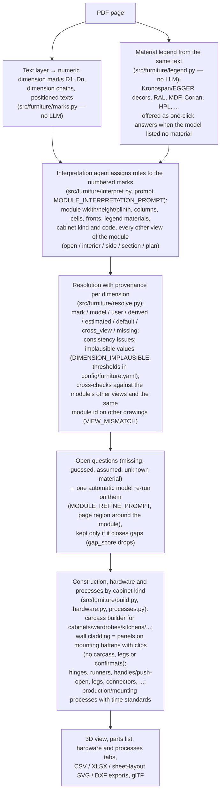
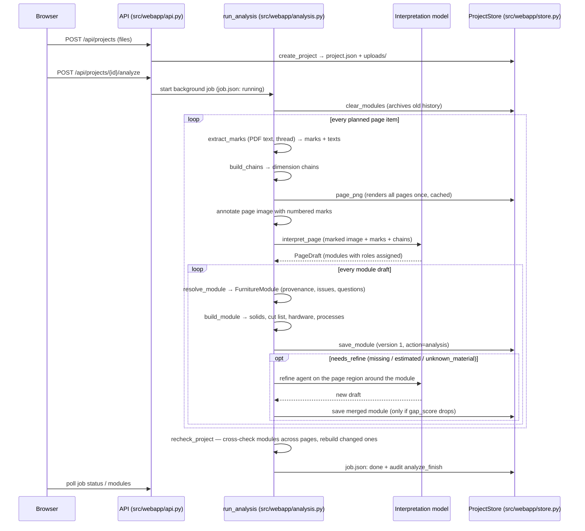

# Architecture

Furniture Assistant has two entry points:

- **The web app** (primary): a FastAPI backend (`src/webapp/`) with a React frontend
  (`webapp/`) that turns an uploaded drawing package into reviewed, versioned modules
  with 3D, cut lists, hardware, processes and valuation. This page is about the web app.
- **The legacy batch pipeline**: `main.py` → `DrawingPipeline.process_drawing()` walks
  every page of every drawing under a directory with an exploration agent + tools,
  summarizes to an `ExtractionResult`, validates, and writes JSON/XLSX/review/token
  reports under `results/` (`make run`, `make run-project PROJECT="<dir under
  sample-data>"`, `make benchmark`). It shares the document loader, config and agent
  infrastructure with the web app but not the furniture domain layer.

## Web app pipeline: drawing → 3D

The split between deterministic code and the model is the core idea: whatever the PDF
text layer states exactly is read without a model; the model only interprets.



A cabinet drawn as several elevations stays one module per wall/run, grouped under its
cabinet code (`group_id`, e.g. `ZM03`); kind (`cabinet`, `wardrobe`, `kitchen`,
`shelving`, `bench`, `reception_desk`, `wall_cladding`, `other`) and code come from the
model, with a keyword/code fallback, and can be changed in the module header. Raster
pages (PNG/JPG/scans/DWG renders) have no text layer: their dimensions come from the
model and are flagged `UNVERIFIED_DIMENSIONS`.

## Analysis job sequence

`POST /api/projects/{id}/analyze` (HTTP 202) starts `run_analysis`
(`src/webapp/analysis.py`) in the background. One job item per analysable page:



Module edits, model re-runs and analyses are serialized per project with an in-process
`threading.RLock` (`ProjectStore.lock`) — one of the reasons the app must run as a
single uvicorn worker (see [Operations](operations.md) and
[Production readiness](production-readiness.md)).

## Module map

### `src/furniture/` — drawing → 3D domain

| File | Purpose |
|------|---------|
| `schema.py` | Pydantic models and literal types: marks, chains, modules, cells, issues, questions, overrides, drafts, `ModuleModel` (see [Data model](data-model.md)) |
| `marks.py` | Deterministic dimension marks from the PDF text layer, grouped into dimension chains; unit detection (cm/mm) |
| `legend.py` | Material legend parsed from the page text: decor names, RAL, MDF, Corian, HPL… → `MaterialSpec` list |
| `annotate.py` | Page images with numbered dimension-mark labels (interpretation-agent input) and marked region crops (refine input) |
| `interpret.py` | Interpretation and refine agents (`create_interpretation_agent`, `create_refine_agent`, `interpret_page`) |
| `resolve.py` | Draft + marks + chains → `FurnitureModule`: provenance, view cross-checks, issues, questions, `apply_overrides`, `gap_score` |
| `build.py` | Rule-based carcass builder: module layout → positioned panel solids → cut list (`build_module`) |
| `hardware.py` | Fittings from construction and drawing text: hinges, runners, handles/push-open, rails, legs, connectors (`derive_hardware`) |
| `processes.py` | Production/mounting process lines with time standards (`derive_processes`) |
| `nest.py` | Sheet nesting of cut-list panels (rectpack, guillotine) and the SVG sheet layout |
| `export.py` | Cut-list CSV/XLSX, nested-sheet SVG, panel DXF writers |
| `reports.py` | Material and process summaries: boards with sheet utilization, edge banding, hardware; module × process matrix |
| `pricing.py` | `Pricing` rates (workspace + project override), valuation lines, unpriced rules, valuation XLSX |
| `quote.py` | Client-quote workbook parsing and comparison: match rows to cabinets, suggested markup from the median ratio |
| `rules.py` | `ConstructionRules` loaded from `config/furniture.yaml`: thicknesses, hardware standards, process minutes, plausibility limits |

### `src/webapp/` — FastAPI backend

| File | Purpose |
|------|---------|
| `api.py` | The app: lifespan (`.env`), auth middleware wiring, projects, analyze, modules (get/put/answers/refine/versions/restore), exports, page PNGs, health, static UI |
| `reports.py` | APIRouter for reports: material/process summaries, valuation (+XLSX), workspace and project pricing, quote upload/comparison |
| `store.py` | `ProjectStore`: file-backed projects, cached page renders, module versions, audit log, job state, per-project lock |
| `analysis.py` | Background jobs: `run_analysis`, `refine_stored_module`, `recheck_project`, draft merging |
| `auth.py` | Optional session auth: `fa_session` cookie (signed), users file, login throttling, `PUBLIC_API_PATHS` |
| `users.py` | CLI to manage users: `uv run python -m src.webapp.users add/remove/list` |
| `openapi.py` | Exports the OpenAPI schema for the frontend type generator (`make web-types`) |

### `webapp/src/` — React frontend

| File | Purpose |
|------|---------|
| `main.tsx` | Entry point |
| `App.tsx` | Routes, auth state, `ErrorBoundary` around the router |
| `ErrorBoundary.tsx` | Catches render errors, offers a Reload button |
| `NewProject.tsx` | Project creation and file upload |
| `ProjectView.tsx` | Project list, project sidebar (grouped by `group_id`, attention badge), module navigation |
| `ModuleView.tsx` | The module page: header (kind/code/title), drawing, 3D, parts, hardware, processes, Review tab, glTF export |
| `ModuleEditor.tsx` | Editor form for module and cell values |
| `DrawingPane.tsx` | Drawing page viewer with mark overlays and crops |
| `ModelPane.tsx` | R3F/Three.js 3D view of the panel solids |
| `PartsList.tsx` | Cut-list table, hover/select synced with the 3D view |
| `Reports.tsx` | Materials, processes, valuation, pricing settings, quote comparison |
| `AdditionalPages.tsx` | Project Review page, Activity page, History panel, question crops |
| `api.ts` | Fetch client, `ApiError`, `fa-unauthorized` event on 401 |
| `api-types.ts` | TypeScript types generated from the OpenAPI schema — do not edit |
| `types.ts` | Hand-written aliases over `api-types.ts` |
| `auth.ts` | Auth context (`useAuth`) |

## Project directory layout

All state is plain files under `<output.dir>/webapp/projects/` (`FA_OUTPUT_DIR` overrides
the root, see [Configuration](configuration.md)). One directory per project:

```
<project_id>/                      # 20260121_143005_a1b2c3 — timestamp + token
├── project.json                   # id, name, created_at, files[] (index, name, drawing_type)
├── uploads/                       # original uploaded files (names de-duplicated)
├── pages/                         # cached PNG renders: {file_index}_{page_index}.png
│                                   # (first request renders every page of the file)
├── modules/
│   ├── <module_id>.json           # latest ModuleModel (module + solids + cut list + ...)
│   ├── history/
│   │   └── <module_id>/
│   │       ├── 1.json, 2.json, …  # one file per version (full ModuleModel)
│   │       └── index.json         # version, at, user, action, summary per version
│   └── history-archive-<ts>/      # history moved here on re-analysis (never deleted)
├── audit.jsonl                    # activity: at, user, action, module_id, detail
├── pricing.yaml                   # project pricing override + markup (optional)
├── quote.xlsx                     # uploaded client quote workbook (optional)
├── quote.json                     # parsed quote lines (optional)
├── job.json                       # last analysis job, including request/token totals and page/module breakdown
└── usage.json                     # cumulative project request/token totals across analyses and refinements
```

Writes go through `_write_atomic` (temp file + `os.replace`) so a crash never leaves a
half-written JSON; module saves, audits and job updates happen under the project lock.
Backups are a copy of this directory tree (see [Operations](operations.md)).
