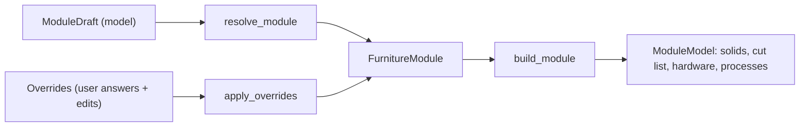

# Data model

All models live in `src/furniture/schema.py` (Pydantic). The web app stores them as JSON
in the project directory (see [Architecture](architecture.md#project-directory-layout));
the frontend consumes the same shapes through generated TypeScript types
(`make web-types`, see [Development](development.md)).

## Source of truth: draft + overrides → module

A saved module is a `ModuleModel` whose `module` field is **recomputed**, never edited
in place:

- The interpretation model produces a `ModuleDraft` (roles assigned to numbered marks).
- `resolve_module` turns the draft + the page's marks/chains/texts into a
  `FurnitureModule` with provenance, issues and open questions.
- Every user answer or editor change is stored as an `Override` in
  `ModuleModel.overrides`; `apply_overrides` (re)builds the module from
  `draft` + `overrides` (`assemble_module`). A module created or edited by hand has no
  draft; overrides then apply to `base_module`.
- `build_module` derives solids, cut list, hardware and processes from the module after
  every change.

Consequences: overrides survive model re-runs ("Ask the model again" merges a new draft
under the user's latest overrides), every dimension keeps its provenance, and the Review
tab shows exactly what the drawing did not provide. See
[Review workflow](review-workflow.md).

## Dimension marks and chains

`extract_marks` (`src/furniture/marks.py`) reads every numeric text object of the PDF
page and groups marks that lie on one line into chains.

::: src.furniture.schema.DimensionMark

::: src.furniture.schema.DimensionChain

A chain whose sum contradicts its overall mark (`consistent: false`) becomes a
`CHAIN_MISMATCH` issue when its marks are used. Marks on raster pages
(`source: "vlm"`) are produced by the vision model instead of the text layer.

## The module

::: src.furniture.schema.FurnitureModule

Layout is a grid: `columns[]` each with `width_mm` and a stack of `cells[]`. Fronts,
shelves and materials hang off the cell; the builder turns the grid into positioned
panel solids (overlay construction, coordinates in mm).

::: src.furniture.schema.Column

::: src.furniture.schema.Cell

Cell fronts (`FrontType`): `door_left`, `door_right`, `door_double`, `drawer`, `open`,
`niche_appliance`, `panel_fixed`. Front type drives hardware (hinges per door leaf,
runners per drawer) and the builder (front panels, drawer boxes).

## Issues

`validate_module` (`src/furniture/resolve.py`) attaches `Issue` records to the module.
All twelve codes:

| Code | Severity | Meaning |
|------|----------|---------|
| `CHAIN_MISMATCH` | error | A dimension chain's sum contradicts its overall mark |
| `COLUMNS_NOT_SUM` | error | Column widths do not sum to the module width |
| `ROWS_NOT_SUM` | error | Cell heights in a column do not sum to the carcass height (height − plinth) |
| `DIMENSION_MISSING` | error | Width or height could not be resolved (or height ≤ plinth) — no 3D model is built |
| `DEPTH_ASSUMED` | warning | Depth not shown on the page; the construction default from `config/furniture.yaml` was used |
| `UNVERIFIED_DIMENSIONS` | warning | Raster page: dimensions were read by the vision model, no printed mark confirms them |
| `NICHE_NONSTANDARD` | warning | Appliance niche width is not one of 450/600/900 mm |
| `SHELF_SPAN` | warning | Shelf span exceeds 900 mm — sagging risk |
| `DOOR_TOO_WIDE` | warning | Single door wider than 600 mm |
| `MATERIAL_UNKNOWN` | warning | A referenced material key is not in the page's legend |
| `VIEW_MISMATCH` | error | A dimension differs between two views of the module, or between drawings showing the same module id |
| `DIMENSION_IMPLAUSIBLE` | warning | Width/height/plinth or column/cell dimension outside the plausibility limits of `config/furniture.yaml` |

## Questions and overrides

::: src.furniture.schema.Question

Question reasons (`QuestionReason`):

| Reason | Meaning |
|--------|---------|
| `missing` | The drawing did not give the value at all |
| `estimated` | Value was guessed by equal share (e.g. equal columns without inner marks) |
| `assumed` | A construction default was used (typically the depth) |
| `unknown_material` | The material key is not in the legend |
| `conflict` | The value takes part in a contradiction (error issue) |
| `model_unsure` | The model flagged the value as uncertain in its answer |
| `unverified` | The model read a value that no printed mark confirms |

Reasons with consequences: questions with `missing`, `estimated` or `unknown_material`
trigger the automatic refine re-run after analysis; `missing`, `unknown_material`,
`conflict` and `model_unsure` count as "needs attention" (sidebar badge).

::: src.furniture.schema.Override

Override targets:

| Target | Set by | Fields used |
|--------|--------|-------------|
| `width`, `height`, `depth`, `plinth` | module dimensions | `value_mm`, or `mark_id` (the value of that printed mark) |
| `col:<index>:width` | a column | `value_mm` / `mark_id` |
| `cell:<cell_id>:height` | a cell | `value_mm` / `mark_id` |
| `cell:<cell_id>:front` | a cell | `front` (`FrontType`) |
| `cell:<cell_id>:shelves` | a cell | `shelves` (count) |
| `cell:<cell_id>:material` | a cell | `material_key` (existing) or `material` (new legend entry) |
| `material:carcass`, `material:front` | module materials | `material_key` / `material` |
| `kind` | module header | `kind` (`CabinetKind`) |
| `group` | module header | `group_id` (cabinet code) |

Question ids are override targets: answering a question records an override (and marks
the target confirmed in `FurnitureModule.confirmed`); editor edits record overrides the
same way. That is the single feedback mechanism — see
[Design decisions](decisions.md#overrides-as-the-single-feedback-mechanism).

## Provenance

Every resolved dimension carries a `Provenance` (`mark`, `model`, `user`, `derived`,
`estimated`, `default`, `cross_view`, `missing`):

| Value | Meaning |
|-------|---------|
| `mark` | Read from a printed dimension mark |
| `model` | Read by the vision model (no mark confirms it) |
| `user` | Set or confirmed by the user (override) |
| `derived` | Exact remainder of known dimensions |
| `estimated` | Equal-share guess |
| `default` | Construction-rule default (`config/furniture.yaml`) |
| `cross_view` | Taken from another view or drawing of the same element |
| `missing` | No value at all |

`FurnitureModule.dimension_sources` maps `width`/`height`/`depth`/`plinth` to their
provenance; `Column.width_source` and `Cell.height_source` do the same per element.

## Cabinet kinds

`CabinetKind`: `cabinet`, `wardrobe`, `kitchen`, `shelving`, `bench`,
`reception_desk`, `wall_cladding`, `other`. The kind comes from the model (with a
keyword fallback over title and nearby text in `_infer_kind`) and is editable in the
module header (`kind` override).

What the kind actually changes:

- **`wall_cladding`** — a different build path (`build_cladding`): decorative panels on
  mounting battens; no carcass box, plinth, dividers, legs or confirmats. Hardware is
  mounting clips and screws per batten metre. Installation time is per m². The
  plausibility check applies `wall_cladding_depth_min_mm` (10 mm) instead of the
  furniture depth minimum. Battens, cladding thickness and spacing come from
  `config/furniture.yaml`.
- **`bench`** — the only kind with a hardware exclusion
  (`disabled_categories_by_kind`): no adjustable legs.
- **All other kinds** — share the same carcass builder. Hardware follows the fronts and
  the drawing text (hinges per door leaf by its built height, runners sized to the
  largest standard length that fits the drawer box, handles or push-to-open when the
  text says so, hanging rails where "drążek" is printed, legs scaled by width,
  confirmats by joints and depth), not the kind itself. The kind still matters for
  grouping, valuation display and review expectations.

## Built output

::: src.furniture.schema.ModuleModel

`ModuleModel` is what the API serves and what is stored in
`modules/<module_id>.json`: the resolved `module`, derived `solids` (`PanelSolid`,
mm boxes), `cut_list` (`Panel` rows), `hardware` (`HardwareItem`), `processes`
(`ProcessLine` with minutes), the originating `draft`/`base_module`, the `overrides`
and the `refine_*` state of the last model re-run.
