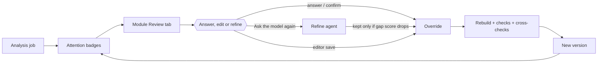

# Review workflow

Extraction keeps everything deterministic where the drawing prints it (dimension marks, legend text) and uses the model only to assign roles and read what is not printed. Whatever remains open becomes a **question** on the module — one per override target — with a reason that says why it is asked. Review is the loop of answering those questions; every answer, confirmation or editor change becomes an **override**, the single feedback mechanism (see [Data model](data-model.md)). The module is always rebuilt as *model interpretation + overrides*, so fixes survive model re-runs and re-analysis.

## Attention badges

Questions are ranked, and only some of them need a human. The badge counts in the project sidebar count questions with a reason in `ATTENTION_REASONS` (`src/furniture/resolve.py`): **missing**, **unknown_material**, **conflict**, **model_unsure**. The tooltip reads "N need attention, M to review" (M = all open questions).

Where attention surfaces:

| Place | Signal |
|---|---|
| Sidebar module list | attention badge, `done`/`incomplete` status pill, error-issue count, spinner while a model re-run is in flight; group headings sum the badge |
| Module tabs | "Review (N)" — N = all open questions of the module |
| Drawing and 3D tab | "Highlight uncertain" toggle colours the parts touched by open questions (cell/column questions highlight their cells; module-level questions highlight carcass/back/plinth) |
| Parts list | "Review" badge on rows whose parts are affected |
| Project Review page | all open questions across modules (see below) |

## Question reasons

A target asked for several reasons is shown with the most important one (`missing` > `unknown_material` > `conflict` > `estimated` > `model_unsure` > `unverified` > `assumed`).

| Reason | Review-tab label | Meaning |
|---|---|---|
| `missing` | Missing | the drawing gives no value for the target |
| `estimated` | Estimated | an equal-share guess (e.g. a remaining width split across columns) |
| `assumed` | Default | a construction-rule default (`config/furniture.yaml`), e.g. depth with no section/plan on the page, or the plinth height |
| `unknown_material` | Unknown material | no material key for the carcass, front or a cell |
| `conflict` | Contradiction | the value takes part in a contradiction (an error issue, e.g. column widths not summing to the module width) |
| `model_unsure` | Model unsure | the interpretation agent flagged the target as uncertain |
| `unverified` | Not confirmed by a dimension | the model read a value that no printed mark confirms (raster pages) |

Question kinds: `dimension` (mm value), `material`, `front` (door/drawer type of a cell) and `shelves` (count). Reasons `missing`, `estimated` and `unknown_material` (`REFINE_REASONS`) are also the ones a model re-run can close; after the first analysis pass each module with such questions gets one automatic focused re-run (`src/webapp/analysis.py`).

## The module Review tab

The tab opens with two groups and one collapsed section, each question as a card:

- **Missing** — reasons `missing`, `unknown_material`: something to provide.
- **Please check** — `conflict`, `estimated`, `model_unsure`, `assumed`: something to verify.
- **Unverified readings** (collapsed) — `unverified` model-read values; usually dispatched with "Confirm all readings".

Each card shows the question label, its reason badge, the note explaining why it is asked, a crop of the drawing around the module (candidate marks boxed in red) and the current value. Answer controls per kind:

| Kind | Controls |
|---|---|
| dimension | "Value (mm)" input; "Candidate marks" chips — printed marks near the target, shown as `mark id · value unit`; picking one pins the answer to that printed mark (provenance `mark`); "Pick on drawing" selects the mark by clicking it on the drawing pane |
| material | "Existing material" select (module materials plus legend entries parsed from the page); "Suggested materials" chips from the legend; or a new material with a name and kind |
| front | Front select (door left/right, double door, drawer, open, appliance niche, fixed panel) |
| shelves | Shelves count |

Buttons: **Confirm** accepts the current value as correct; **Confirm all readings** confirms every `unverified` value at once; **Apply answers** submits everything staged in the tab. The "Applied overrides" table lists what is set, with **Remove** (an override without values removes the target's override; confirmed targets can be asked about again only when they go `missing`).

Answers go to `POST …/answers`, which merges the overrides, re-assembles the module (draft + overrides), re-runs the checks (`finalize_module`), saves a new version and then re-runs the project cross-checks — a dimension change can rebuild sibling modules drawn on other pages.

## Editing

The **Edit** button opens the module editor: per-cell front/shelves/height/material, column widths, module dimensions and carcass/front materials; the header also has a "Cabinet kind" select and a "Cabinet group" code field (kind changes hardware and processes; the group links walls/runs of one cabinet). Saving diffs the edit against the current module, converts the differences into overrides (`overrides_from_edit`) and follows the same rebuild path as answers — the model interpretation is never overwritten, so refining still works afterwards. Hand-made modules (no model draft) instead bake the edit into their base.

## Ask the model again

The Review tab's **Ask the model again** button sends the page region around the module — all of its views, with mark labels rendered on — to the refine agent for a fresh interpretation of just this module.

- The call runs in the background (`refine_status: running`); the tab shows "Model is reviewing open questions · attempt N" and polls the module every 2 s (the UI gives up after 5 minutes and asks for a page refresh).
- The result is applied to the module **as stored at that moment**: edits made during the run are not lost, and user overrides always win over model values.
- The new draft is kept only if it lowers `gap_score` (`src/furniture/resolve.py`): the weighted sum of open questions (`missing` 100, `conflict` 10, `estimated` 10, `unknown_material` 5, `model_unsure` 3, `unverified` 1, `assumed` 1) plus 20 per error issue. If the score does not drop, the module is unchanged and a note "Model re-run found nothing new." is added; if it drops, the module is rebuilt and a note lists which questions were filled ("Model re-run filled: …").
- Failures show as "Refinement failed: …" (`refine_status: error`); a re-run lost to a server restart is reported the same way. Refine is refused (`409`) while another re-run or a project analysis is in flight, and (`422`) on hand-made modules, which have no model interpretation.

## History and restore

Every save that actually changes a module writes a new monotonic version (saved under `modules/history/<module_id>/`, indexed with `at`, `user`, `action`, `summary`; a save that changes nothing adds nothing). Version actions: `analysis` (first pass), `refine`, `editor_save`, `answers`, `recheck`, `restore`. The **History** tab lists them newest first; **Restore** re-saves an old version as a *new* version (history is never rewritten) and re-runs the cross-checks. Re-running the project analysis archives the whole version history into `history-archive-<timestamp>/` and starts fresh — old geometry is kept on disk but not restorable, because restoring it into a new analysis would resurrect stale dimensions.

## Project Review page

`Review` in the project sidebar aggregates every module's open questions in one list: filter by reason, grouped by cabinet group, with "Confirm current value" inline and "Open module review" deep-linking into the module's Review tab (`?tab=review`). Unverified readings sit behind a collapsed section here as well. This page is the fastest path to clear a whole package; the module Review tab is where marks get picked and the model re-asked.

## Activity

The **Activity** page renders the project's `audit.jsonl` (When, User, Action, Module, Details). Recorded actions: `create_project`, `analyze_start`, `analyze_finish`, `editor_save`, `answers`, `recheck`, `refine_start`, `refine_finish`, `restore`, `pricing_change`, `quote_upload`; answers and editor saves include the exact override changes (`target=value`, `target cleared`). The user column is the session username — with auth disabled (no users configured) everything is recorded as `system`, which limits the page's value to separating system runs from named users.
